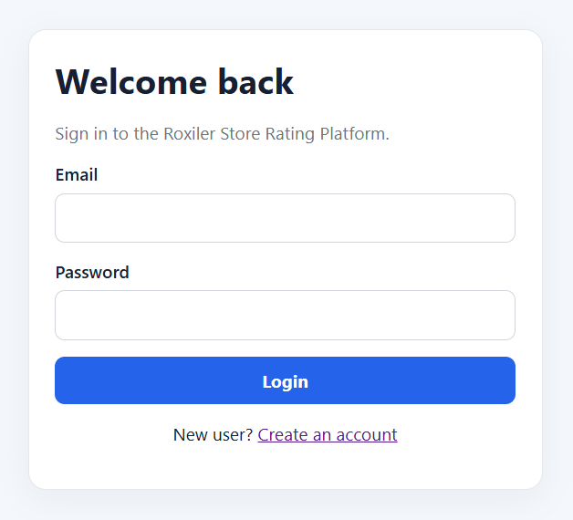
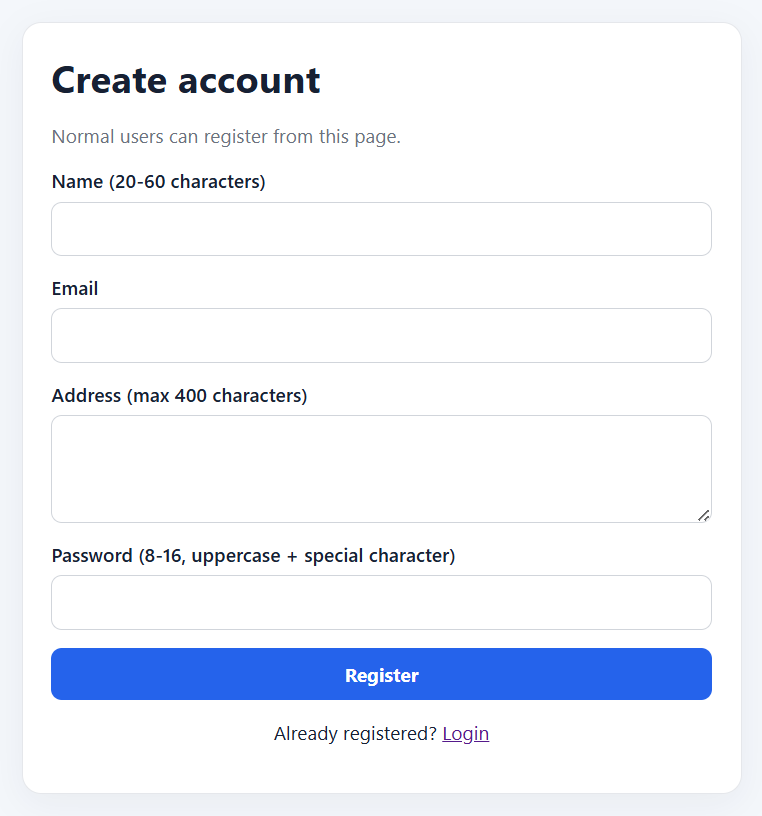
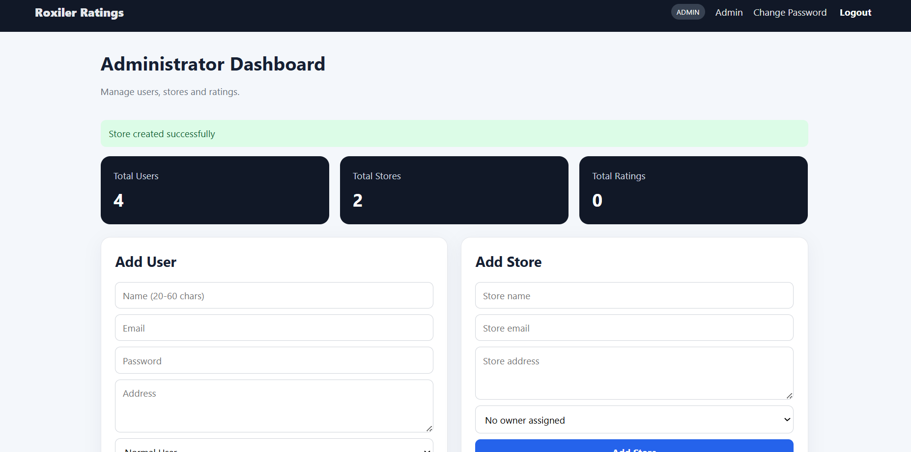
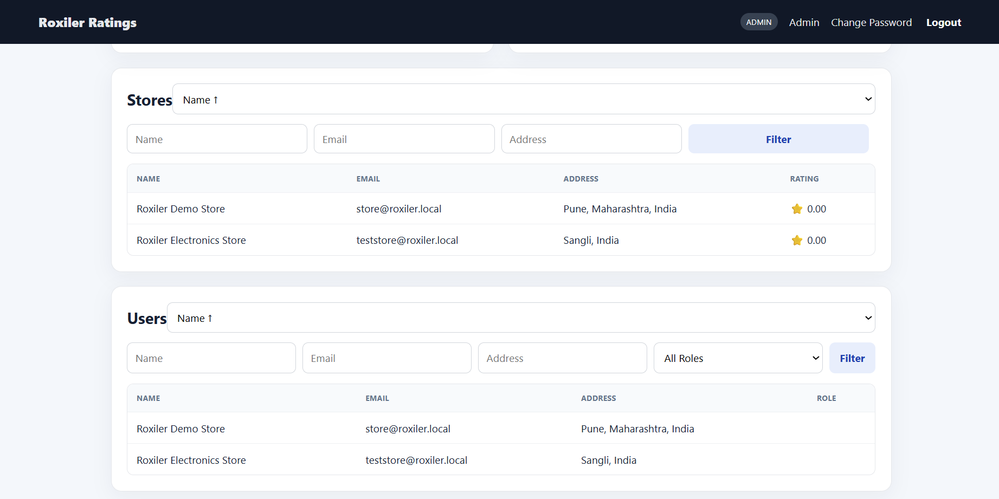
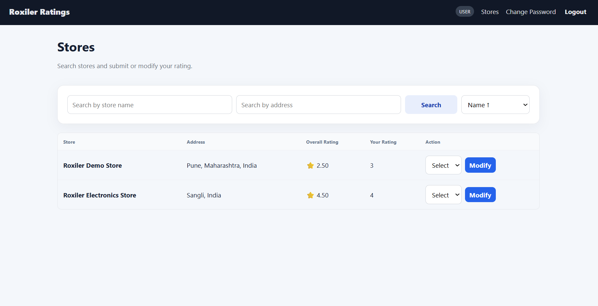
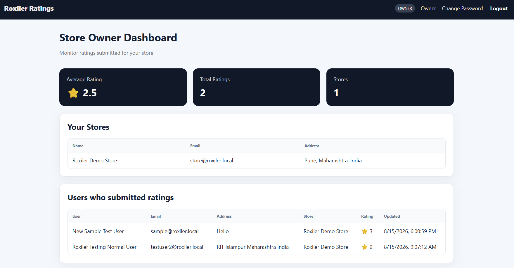

# Store Rating Platform

Full-stack implementation of the Roxiler Systems FullStack Intern Coding Challenge.

## Screenshots

### Login



### Register



### Admin Dashboard






### Normal User Dashboard



### Store Owner Dashboard



## Stack
- Frontend: React + Vite
- Backend: Express.js
- Database: MySQL
- Authentication: JWT
- Password hashing: bcryptjs

The challenge requires React on the frontend, Express/Loopback/NestJS on the backend, and PostgreSQL/MySQL for the database. This implementation uses React + Express.js + MySQL. fileciteturn0file0L2-L11

## Roles
1. System Administrator
2. Normal User
3. Store Owner

The required functionality, validations, filtering, sorting, ratings, and role-specific dashboards are implemented according to the supplied challenge. fileciteturn0file0L13-L36

## 1. Database setup

Create a MySQL database:

```sql
CREATE DATABASE roxiler_rating;
```

Then configure `backend/.env`.

## 2. Backend setup

```bash
cd backend
npm install
```

Copy `.env.example` to `.env` and update:

```env
PORT=5000
DB_HOST=localhost
DB_PORT=3306
DB_USER=root
DB_PASSWORD=your_mysql_password
DB_NAME=roxiler_rating
JWT_SECRET=replace_with_a_long_random_secret
```

Start the server:

```bash
npm run dev
```

The backend automatically creates the required tables.

## 3. Seed demo accounts

In another terminal:

```bash
cd backend
npm run seed
```

Demo accounts:

- Admin: 

    Email: `admin@roxiler.local`, Password: `Admin@123`
- Store Owner:

    Email:  `owner@roxiler.local`, Password: `Owner@123`

A normal user can be registered from the UI.

Important: the supplied challenge requires Name to be 20-60 characters, so use a name of at least 20 characters. fileciteturn0file0L64-L69

## 4. Frontend setup

```bash
cd frontend
npm install
```

Copy `.env.example` to `.env`:

```env
VITE_API_URL=http://localhost:5000/api
```

Run:

```bash
npm run dev
```

Open the URL printed by Vite, normally `http://localhost:5173`.

## Main API routes

### Auth
- POST `/api/auth/register`
- POST `/api/auth/login`
- PATCH `/api/auth/password`

### Admin
- GET `/api/admin/stats`
- GET `/api/admin/stores`
- POST `/api/admin/stores`
- GET `/api/admin/users`
- POST `/api/admin/users`
- GET `/api/admin/users/:id`

### Normal user
- GET `/api/stores`
- POST `/api/stores/:storeId/rating`
- PUT `/api/stores/:storeId/rating`

### Store owner
- GET `/api/owner/dashboard`

## Security
- JWT authentication
- Role-based authorization middleware
- bcrypt password hashing
- Parameterized SQL queries
- Server-side validation
- Rating restricted to integers 1-5
- Unique `(user_id, store_id)` rating constraint
- Passwords are never returned by user APIs

## Requirement coverage

### Administrator
Dashboard counts, store management, user management, role filters, store/user listings, user detail view, and logout are implemented. fileciteturn0file0L18-L36

### Normal user
Signup, login, password update, store search, overall rating, own rating, submit/modify rating, and logout are implemented. fileciteturn0file0L39-L56

### Store owner
Login, password update, average store rating, and users who rated the store are implemented. fileciteturn0file0L57-L63

### Validation/sorting
Name, address, password and email validations are implemented. Listings support ascending/descending sorting. fileciteturn0file0L64-L74
